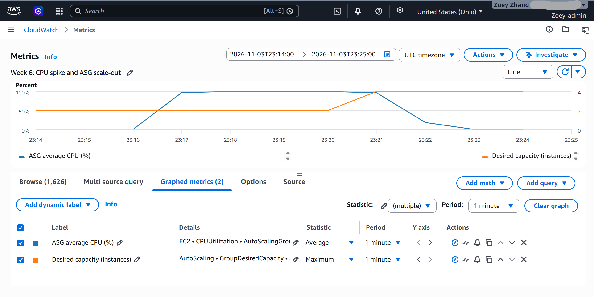
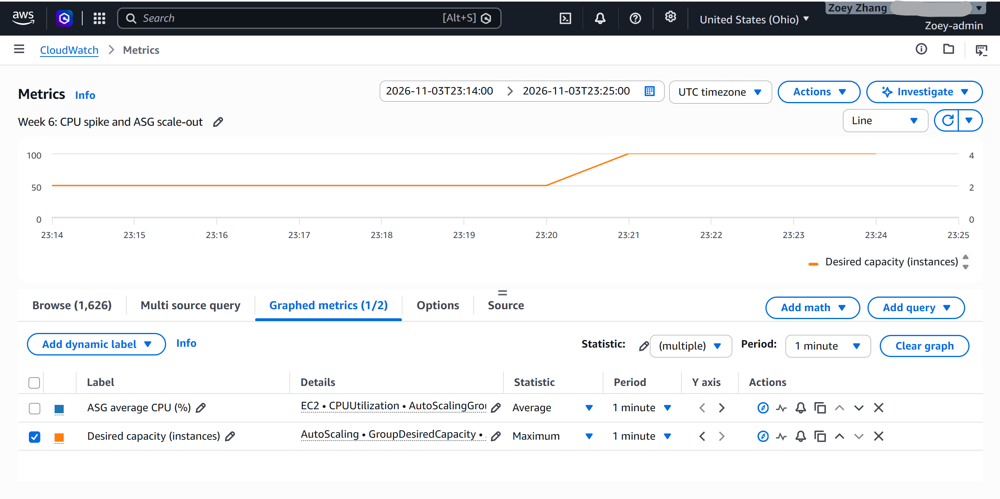

# Week 6 Load Test Report

I tested PropertyLite behind an Application Load Balancer (ALB) and an Auto Scaling group (ASG) in AWS Ohio on November 3, 2026. The ASG started with two `t3.micro` instances and could scale up to four. I set its target tracking policy to 50% average CPU.

## Test

First, I checked that the ALB returned a successful response from `/health` and that both instances were healthy. Then I used Systems Manager to run `stress-ng --cpu 2 --timeout 600s` on both instances. The load test started at about **5:16 PM CST**. I watched the CPU and desired capacity metrics in CloudWatch.

## Results

- At **5:17 PM CST** (**23:17 UTC**), average CPU first went above the 50% target and reached **96.81%**.
- At **5:20:42 PM CST**, the scaling policy changed desired capacity from **2 to 4**.
- At **5:21 PM CST** (**23:21 UTC**), the one-minute CloudWatch graph showed the capacity increase.

The gap from the first high CPU reading to the scale-out action was **3 minutes 42 seconds**. I used the [CPU metric data](evidence/cpu-metrics.json) and [scaling activity record](evidence/scaling-activities.json) for the exact times. The graphs show about four minutes because their data points are one minute apart.

These are my screenshots from the CloudWatch console. Both graphs use UTC.

After scaling out, all four instances passed the ALB health check. I also tested self-healing by terminating one instance earlier; the ASG launched a replacement. I deleted the lab resources after collecting the results.
