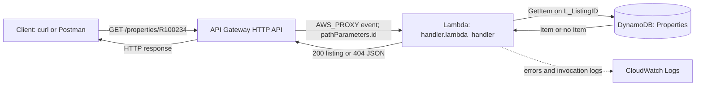
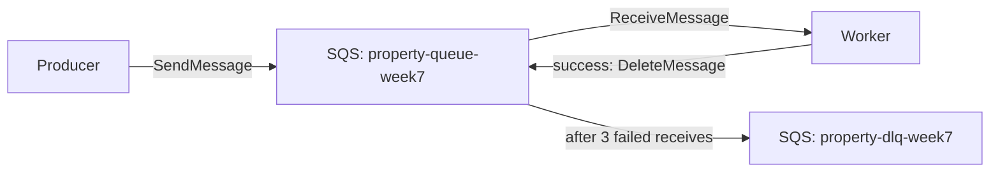

# Week 7 - Serverless and event-driven PropertyLite

This lab ports PropertyLite's `GET /properties/<listing_id>` read path from Flask and a CSV file to an HTTP API, Lambda, and DynamoDB. It also creates an SQS queue with a dead-letter queue (DLQ). The API is a disposable lab in `us-east-2`, consistent with earlier weeks. The checked-in code, curl collection, and Postman collection can recreate and verify it.

## Request path



The Lambda execution role grants `dynamodb:GetItem` on only `arn:aws:dynamodb:us-east-2:<account-id>:table/Properties`. Its separate `AWSLambdaBasicExecutionRole` policy permits CloudWatch logging. API Gateway has permission to invoke this function for the property route. The function runs outside a VPC and does not need network access to a private database.

`handler.py` returns the same seven string-valued fields as the original CSV-backed route. A missing ID returns `{"error":"not found"}` with HTTP 404; an event missing `pathParameters.id` returns HTTP 400. DynamoDB permission or table errors surface as HTTP 500 and their stack traces appear in the Lambda CloudWatch log group; the function does not echo those internal details to clients.

## Reproduce the lab

Prerequisites: authenticated AWS CLI with permission to create/delete DynamoDB, IAM, Lambda, API Gateway, SQS, and their CloudWatch logs; Python 3; curl; and Ubuntu WSL or another Bash environment. Run from this folder:

```bash
python3 -m unittest -v test_handler.py
bash lab.sh deploy
bash lab.sh verify
bash lab.sh cleanup
```

`deploy` refuses to overwrite an existing `Properties` table or named lab resources. It creates a `PAY_PER_REQUEST` table keyed by string `L_ListingID`, loads the three rows of the approved seven-column `propertylite/rets_property_sample.csv`, packages the Lambda, creates the least-privilege role, and deploys the HTTP API's `GET /properties/{id}` route. Week 4's cleaned RDS table was deleted during its cleanup, so this lab uses the checked-in sanitized training sample. It does not read the raw `rets_property.sql` dump. The sample ID `R100234` has the same JSON shape and values on the original Flask route and this new route.

`verify` runs [the curl collection](curl-collection.sh) against the deployed endpoint: one successful listing and one missing listing. To run it directly, set `BASE_URL` to the printed API Gateway endpoint and use these requests:

```bash
BASE_URL=https://<api-id>.execute-api.us-east-2.amazonaws.com bash curl-collection.sh
curl -i "$BASE_URL/properties/R100234"
curl -i "$BASE_URL/properties/DOES-NOT-EXIST"
```

The first response should be HTTP 200 with `L_ListingID=R100234` and `L_City=Sacramento`; the second should be HTTP 404 with `{"error":"not found"}`. The collection asserts both status and body. `verify` also checks the SQS redrive policy, sends `{"PropertyId":"R100234"}` to `property-queue-week7`, receives that body, and deletes the test message.

For Postman, import [PropertyLite-Week7.postman_collection.json](PropertyLite-Week7.postman_collection.json) using **Import > File**. Set the collection's `baseUrl` variable to the API endpoint printed by `bash lab.sh deploy` (for example, `https://<api-id>.execute-api.us-east-2.amazonaws.com`), then run the collection. It contains the same two GET requests and post-response tests for the 200 and 404 status codes and JSON bodies. The previous lab endpoint was deleted during cleanup, so deploy again before running either collection.

## SQS path and troubleshooting



The queue is configured with `maxReceiveCount=3`. The successful receive in this exercise does not trigger the DLQ; the DLQ is for messages a consumer repeatedly fails to process.

For an API Gateway 500, inspect Lambda's most recent CloudWatch log stream first. `AccessDeniedException` points to the Lambda role's table ARN or `GetItem` action; `ResourceNotFoundException` points to the region or table name; a missing route parameter points to the API route key or event payload. The deployed route must be exactly `GET /properties/{id}`. Check `aws lambda get-policy --function-name propertylite-week7-get-property --region us-east-2` if API Gateway cannot invoke the function.

On November 11, 2026, the deployed API returned the full `R100234` listing with HTTP 200 and `{"error":"not found"}` with HTTP 404 for an unknown ID. The SQS redrive policy showed three receives before DLQ routing, and a sent property message was received and deleted. The first API request returned HTTP 500 because the Lambda's initial three-second timeout expired; CloudWatch showed `Status: timeout`. Increasing the timeout to ten seconds resolved it, and the deploy script now sets that value.

`cleanup` deletes this lab's API, Lambda, role, queues, table, and Lambda log group, then removes `.lab-state`. The script records only lab resource IDs and URLs in the ignored `.lab-state` file. Check the Billing dashboard separately for charges and take the weekly screenshot if required by the handbook's standing checklist.

After cleanup on November 11, independent AWS CLI queries found no `Properties` table, lab Lambda, HTTP API, IAM role, either SQS queue, or Lambda log group.
